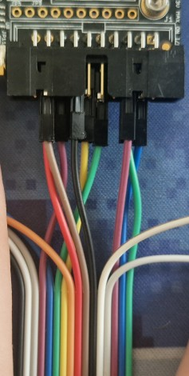
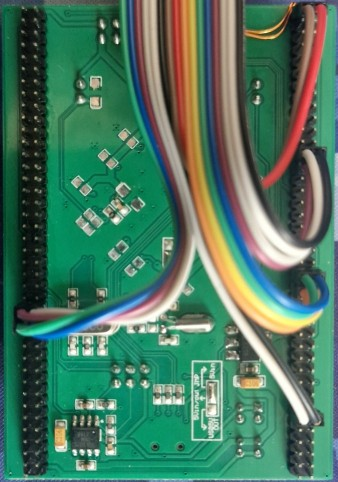

# Programming the Pinata using CW

You can program the pinata using the following script:

```python
hex_binary = 'simpleserial-fi-bike-PINATA_extclk.hex'
baudrate = 921600
# baudrate = 230400

import chipwhisperer as cw

scope = cw.scope()
scope.default_setup()

def power_cycle():
  import time
  scope.io.target_pwr = False
  time.sleep(1)
  scope.io.target_pwr = True

scope.io.pdic = 'high'
power_cycle()

cw.program_target(scope, cw.programmers.STM32FProgrammer, hex_binary, baud=baudrate)

scope.io.pdic = 'low'
power_cycle()


target = cw.target(scope, cw.targets.SimpleSerial2)

```

For this to be the case we can have the BOOT_CONFIG pin in any setting. As it is the boot1 pin it wil only determine outside of programming what memory area we are resetting to. As such for doing actual stuff with the board, the FLASH setting is better as after a reset, the board will load the program from the flash instead of doing nothing.

BOOT_CONFIG switch (boot1 pin):

| Boot1 BOOT_CONFIG switch | Boot0 pin / PDIC |       meaning       | source |
| :----------------------: | :--------------: | :-----------------: | :----: |
|         x / N/A          |        0         |  Main flash memory  | RM0090 |
|        0 / FLASH         |        1         | internal bootloader | AN2606 |
|        0 / FLASH         |        1         |    System memory    | RM0090 |
|        1 / SYSTEM        |        1         |    Embedded SRAM    | RM0090 |

| Switch direction | Voltage |
| ---------------- | ------- |
| FLASH            | GND     |
| SYSTEM           | 3V3     |

~~To program the Pinata the BOOT_CONFIG switch on the board needs to be in the ANY direction. The BOOT direction sets the STM32 to boot from the internal flash.~~

We need to be connected to these pins for programming:

| STM32 pin | CW pin |
| --------- | ------ |
| boot0     | PDIC   |
| PC10      | IO1    |
| PC11      | IO2    |
| rst       | nRST   |

It might be that the firmware needs to be intially flashed to both SYSTEM and FLASH before the serial bootloader will consistently work. This is just conjecture but definitely a good debugging step.

## Notes on board

By default the board is configured to output the sysclk and HSE clock.

| STM32 pin | function | clock signal |
| --------- | -------- | ------------ |
| PA8       | MCO1     | HSE          |
| PC9       | MCO2     | sysclk       |

## Clock source

The build system uses the `MCU_CLK` define to determine which clock signal is used for sysclk.

| MCU_CLK | meaning        | note                  |
| ------- | -------------- | --------------------- |
| INT     | internal clock | sysclk at 16MHz       |
| \*      |                | HSE needs to be 16MHz |

**I think** HSE code could be modified to take a division of a freq

## Chipwhisperer 20 pin pinout

| GND | GND | PDID | PDIC | SCK | MOSI | MISO |  nRST   |  3V3   | 5V  |
| :-: | :-: | :--: | :--: | :-: | :--: | :--: | :-----: | :----: | :-: |
| 5V  | 3V3 | IO4  | IO3  | IO2 | IO1  | VREF | HS2/OUT | HS1/IN | GND |



From the jumper wires we have the following colors:

| Wire color | Signal | CW Pin |
| ---------- | ------ | ------ |
| Green 1    | PH0    | HS2    |
| Blue 1     | PH1    | HS1    |
| Purple 1   | RST    | nRST   |
| Grey 1     | PC0    | Unused |
| White 1    | PB8    | Unused |
| Black 1    | BOOT0  | PDIC   |
| Brown      | GND    | GND    |
| Red        | 3V3    | 3V3    |
| Orange     | PC12   | Unused |
| Yellow     | PC11   | IO1    |
| Green 2    | PC10   | IO2    |
| Blue 2     | PA15   | Unused |
| Purple 2   | PA9    | IO4    |
| Grey 2     | PA8    | MCO1   |
| White 2    | PC9    | MCO2   |
| Black 2    | PC8    | Unused |




### flashing using the st-link
```
st-flash write <file>.bin 0x8000000
```


## CCM memory

https://www.openstm32.org/Using%2BCCM%2BMemory